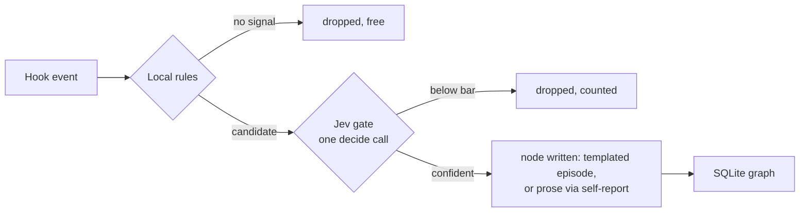

# Experience graph (RFC)

**Status: building.** The code is landing in `knowledge/`, opt in with
`--knowledge`. See [knowledge/README.md](../knowledge/README.md) for what exists
now. This document is still the design of record: the schema and the gating
were argued here first, the same way the rules table was. Nothing is measured
yet, see [measurements](measurements.md#experience-graph).

The kit already has a knowledge graph: `graphify-out/` maps what the code
*is*. This one maps what *happened* while working on it: which errors had
which fixes, which approaches keep working, which calls nearly did damage,
which rules the human has laid down. Code graph and experience graph stay
separate stores, joined only by entity names (a file path, a component, an
error signature).

Flat memory files already exist (`MEMORY.md`, Claude Code auto-memory). The
graph earns its complexity in three places a flat file cannot reach:

- An error signature node with a `fixes` edge answers "we have seen this
  exact failure before, here is what resolved it" across sessions, by match
  rather than by luck.
- A pattern's trust is the count of its `evidence-for` edges. Same philosophy
  as the `Exercised` column in [components.md](components.md): a claim is
  worth what has actually backed it.
- `supersedes` and `contradicts` edges give stale knowledge a mechanism for
  dying. A flat file just accumulates.

## Node types

Eight knowledge buckets, plus entity anchors.

| Bucket | Holds | Born from |
|---|---|---|
| `failure` | An error signature with enough context to match again. | Second tool failure inside 15 minutes. The failure-verdict hook already fires there. |
| `fix` | What resolved a failure. Always carries a `fixes` edge. | A check flipping red to green after a recorded failure. |
| `pattern` | A distilled "do X when Y". Never written directly, only promoted. | Three or more similar `fix` or episode nodes. |
| `danger` | A near-miss: a denied call, a destructive action caught. | An Airlock deny, ask or warn. `airlock/enforce.py` appends one redacted row to a local spool after it prints the verdict, so the deny path stays fast; the capture hook drains the spool on its next event and sends each row through the gate. Repeats of one rule against one tool dedupe for 10 minutes. The spool only writes while the SessionStart hook has touched its marker in the last week, so a machine without `--knowledge` collects nothing. A Belay bounce is not wired yet. |
| `decision` | A choice, its rationale, and the rejected alternatives. | Harvested at a Stop hook or a PR merge. |
| `constraint` | A hard standing rule from the human ("never push to upstream"). | Stated explicitly ("remember:", "from now on", a `/constraint` command). A correction shape in a prompt only triggers an offer, never a write. |
| `doc` | An external reference that answered something, plus what it answered. | A fetch followed by the task resolving. |
| `env` | A machine fact: versions, ports, a flaky service. | Repeated failures with an environment shape. |

There is no `success` bucket. A bare success is noise; a success that matters
is either a `fix` or an `evidence-for` edge into a pattern.

**Entity nodes** are the anchors edges attach to: a file path, a component
name, a command, an error signature, a skill name. They carry no prose of
their own.

**Edges:** `fixes`, `caused-by`, `supersedes`, `contradicts`, `evidence-for`,
`applies-to` (bucket node to entity node).

## How a candidate becomes a node

Three stages. The shape is logtriage's: local rules first, the model only for
the ambiguous remainder, and the writer is never the judge.

**Stage 1, local rules, free.** Hooks emit candidates only on cheap signals:
a repeated failure, an Airlock deny, a red-to-green flip, a correction in a
prompt. No Jev call per tool use. The rules must reject roughly nine in ten
events before anything leaves the machine; if they do not, the write
amplification kills the component.

**Stage 2, Jev classifies, inline.** The whole pipeline is hot path: there
is no batch job, no nightly pass, nothing deferred. One call per candidate
through the [decide server](../decide/README.md) over the warm daemon
(about 0.3 s), at the hook, redacted like every other payload. A hard
timeout, and on timeout or error the candidate is dropped, counted in
`metrics.db`, and the turn is never blocked. The call carries the gate questions and the
lifecycle questions together, because a batch over one context costs about
what one question costs:

1. `store`, yes/no: is this worth keeping at all?
2. `bucket`, choice over the eight types.
3. `novelty`, choice against the three nearest existing nodes: duplicate,
   refines, contradicts, or new.
4. `durability`, score: useful this session only, this repo, or indefinitely.
5. `scope`, choice: this repo, this machine, or global.

Answers act only at the kit's shared 0.8/0.4 bar. Below the bar the candidate
is dropped and counted, so the drop rate is still a tunable number without a
rehearsal mode. Every gate row in `knowledge.jsonl` and `metrics.db` carries
`store_p`, the raw `store` probability, so a drop shows which side of the bar
it sat on.

The `store` wording depends on who wrote the candidate. A hook-born candidate
gets the strict form above. A self-report gets a form that asks whether a
later reader could look the fact up and act on it, because the strict form
left every real self-report between 0.56 and 0.73, under the bar.

Replayed on 13 real self-reports, the actionable form scored 0.84 to 0.96 on
twelve and 0.77 on one. On 20 noise candidates it admitted none. Hook
candidates keep the strict form, because airlock denials score up to 0.79
under the other.

**Stage 3, the node is written, still inline.** Jev never writes prose; that
rule already ships in the decide server's instructions. Jev is the gate and
the router. Authorship splits by birth:

- A hook-born episode (`failure`, `fix`, `danger`, `env`) gets **templated
  text from the captured fields**: the signature, the command, the outcome. A
  hook cannot ask Claude for prose mid-call, and the template is more
  greppable than prose anyway.
- A self-reported node (`decision`, `doc`) is **authored by Claude** through
  the graph's own MCP tool, `graph_log`, at the moment of deciding. The
  trigger rule ships in the server's MCP instructions, the same way the
  decide trigger rule does, so nothing edits a `CLAUDE.md`. Dead ends are the
  point: abandon an approach, log why. There is no transcript mining; what
  the model does not report at the time is not captured, a loss this design
  accepts.

The edges follow the novelty answer: `duplicate` becomes a touch on the
existing node's evidence count, `refines` and `contradicts` become edges,
`new` becomes a node.

One exception: **`constraint` bypasses the confidence gate**, and because of
that it has the strictest capture of any bucket. A false constraint is a
permanent standing order, so in v1 only the explicit path writes:

- **Explicit:** the human says "remember:", "standing rule:", "from now on",
  or calls `graph_log` with bucket `constraint`. A `/constraint` slash
  command is not built yet. Stored with no Jev call, redacted first so a
  token pasted into the rule never lands on disk, with provenance (session id
  and the prompt line it came from).
- **Implicit:** a local heuristic spots a correction shape ("don't", "never",
  "always"). It stores nothing. It may offer once, "want this as a standing
  rule?", and a yes routes through the explicit path. Zero false constraints,
  at the cost of one confirmation.

Constraints are auditable the way recall refs are: a `list` command prints
every constraint with its id and provenance, and `drop <id>` removes one.

## Where it lives

The component dir is `knowledge/`, holding the store module (an importable
library, the way hooks import `airlock/recall.py`), the MCP server and the
installer wiring (`--knowledge`). Hooks go in `hooks/` under the `airlock_*`
naming like every other hook.

The MCP server is its own, exposing `graph_log` (and a read tool later). It
does not ride the decide server: decide's shipped contract is stateless
judgment, Jev never writes, and a stateful write tool would poison that one
clean rule. Two servers, two one-sentence contracts: decide judges,
knowledge remembers. Server-side, `graph_log` runs the same stage-2 gate
before writing; self-reports get judged too.

## Retrieval

Context is the scarce resource, so every injection point carries a pinned
budget.

- **PostToolUseFailure:** the failure's signature is hashed and looked up,
  an exact local match, sub-millisecond, no network. A hit injects **two
  lines**, seen this failure before and the fix that worked, at most once
  per signature per 10 minutes, failure-verdict's dedup discipline. This is
  the moment the graph pays for itself, and it only works at tool-call time.
- **SessionStart:** every `constraint` node always, they are law and there
  should be few (past ten, a printed warning says the list smells). Then
  **at most 5** scope-matching nodes, one line each, 70-character redacted
  previews, the resurface hook's discipline tightened for something that
  fires every session.
- **UserPromptSubmit:** a skill-suggest-shaped hook. One Jev call over the
  prompt and candidate node titles picks **at most 2** nodes, the recipe
  that halved wrong skill loads, and silence is the default: none fits
  injects nothing, and a short or trivial prompt skips the Jev call
  entirely on a local length check.

Retrieval is advice only. Nothing here blocks a call; that stays Airlock's
job.

## Lifecycle

Everything is write-triggered. No timer owns the graph; the recall store
already proves the shape, enforcing its TTL and cap on every write.

- **Promotion:** when a write gives a cluster its third supporting episode,
  the same stage-2 decide call carries one more question, promote or not. A
  pattern's trust is its evidence edge count and is printed with it.
- **Decay:** episode nodes carry a TTL; expiry and caps are enforced on every
  write, the recall store's 7-day/50 MB discipline with numbers to be picked
  from real use. `constraint` nodes never expire.
- **Contradiction:** a confident `contradicts` answer writes the edge and
  resolves it in the same write: the newer node wins, the older is marked
  superseded, both kept. Nothing is deleted silently.

## Invariants

The standard kit set, none negotiable:

- Local SQLite, next to `metrics.db`. Nothing leaves the machine except the
  redacted candidate text in the stage-2 decide call.
- Every string through `airlock/redact.py` before any Jev call.
- Fails open. A dead graph changes nothing about a session.
- Kill switch: one state file, `on` or `off`. No third state, by decision:
  **all or nothing, on from day 1**. The component can skip the kit's usual
  shadow rehearsal because every path is advice-only and fail-open; the worst
  a bad graph can do is print a wrong two-line hint and fill a capped,
  deletable local database. It enters [components.md](components.md) as
  **experimental**, `metrics.db` logs every gate call from the first day, and
  `exercised` is earned from live numbers instead of a rehearsal.

## Open questions

1. Dedup is the hard problem, not classification. "Nearest three existing
   nodes" needs a local similarity measure (name match first, embeddings only
   if that is not enough) and the novelty question is the load-bearing one.
   Measure its accuracy before anything else.
2. **Resolved 2026-10-15:** two-level identity. Exact level, local and free:
   `hash(tool_name + exception_type + normalized_message)` with paths,
   numbers, hex ids and quoted strings replaced by placeholders, and no stack
   frames (frame paths churn with refactors; failure-verdict already works
   from the head of the error alone). Near level: on an exact miss, the
   stage-2 novelty question runs against the three nearest nodes, nearest
   meaning same exception type and entity anchor, ranked by token overlap on
   the normalized message. No embeddings in v1; the live drop and duplicate
   counts in `metrics.db` decide if that is ever needed. The normalizer is a pure function and gets a labelled
   same/different pair set before any hook exists: **milestone 1 of the
   component.**
3. **Resolved 2026-10-15:** no harvest, no transcript mining, no cold path.
   A `decision` is self-reported through `graph_log` at the moment of
   deciding, with the trigger rule in the server's MCP instructions. A
   decision node with an empty rejected-alternatives field is never written.
   What self-report misses goes unmeasured, a loss this design accepts.
4. **Resolved 2026-10-15:** one global database with a `scope` column
   (`repo:<path>`, `machine`, `global`), filtered at read time. Matches the
   `metrics.db` and recall-store precedent: one TTL path, one purge, one kill
   switch. Per-repo stores would orphan exactly the nodes worth the most
   across repos, the `env` and `danger` ones, and dedup would have to search
   both stores anyway.
