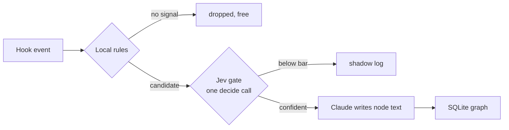

# Experience graph (RFC, no code yet)

**Status: proposal.** Nothing in this document is built. It exists so the
schema and the gating can be argued about before a line of code, the same way
the rules table was.

The kit already has a knowledge graph: `graphify-out/` maps what the code
*is*. This one maps what *happened* while working on it: which errors had
which fixes, which approaches keep working, which calls nearly did damage,
which rules the human has laid down. Code graph and experience graph stay
separate stores, joined only by entity names (a file path, a component, an
error signature).

Flat memory files already exist (`MEMORY.md`, Claude Code auto-memory). The
graph earns its complexity in three places a flat file cannot reach:

- An error signature node with a `fixes` edge answers "we have seen this
  exact failure before, here is what resolved it" across sessions, by match
  rather than by luck.
- A pattern's trust is the count of its `evidence-for` edges. Same philosophy
  as the `Exercised` column in [components.md](components.md): a claim is
  worth what has actually backed it.
- `supersedes` and `contradicts` edges give stale knowledge a mechanism for
  dying. A flat file just accumulates.

## Node types

Eight knowledge buckets, plus entity anchors.

| Bucket | Holds | Born from |
|---|---|---|
| `failure` | An error signature with enough context to match again. | Second tool failure inside 15 minutes. The failure-verdict hook already fires there. |
| `fix` | What resolved a failure. Always carries a `fixes` edge. | A check flipping red to green after a recorded failure. |
| `pattern` | A distilled "do X when Y". Never written directly, only promoted. | Three or more similar `fix` or episode nodes. |
| `danger` | A near-miss: a denied call, a destructive action caught. | An Airlock deny or warn, or a Belay bounce. |
| `decision` | A choice, its rationale, and the rejected alternatives. | Harvested at a Stop hook or a PR merge. |
| `constraint` | A hard standing rule from the human ("never push to upstream"). | A correction in a prompt. |
| `doc` | An external reference that answered something, plus what it answered. | A fetch followed by the task resolving. |
| `env` | A machine fact: versions, ports, a flaky service. | Repeated failures with an environment shape. |

There is no `success` bucket. A bare success is noise; a success that matters
is either a `fix` or an `evidence-for` edge into a pattern.

**Entity nodes** are the anchors edges attach to: a file path, a component
name, a command, an error signature, a skill name. They carry no prose of
their own.

**Edges:** `fixes`, `caused-by`, `supersedes`, `contradicts`, `evidence-for`,
`applies-to` (bucket node to entity node).

## How a candidate becomes a node

Three stages. The shape is logtriage's: local rules first, the model only for
the ambiguous remainder, and the writer is never the judge.

**Stage 1, local rules, free.** Hooks emit candidates only on cheap signals:
a repeated failure, an Airlock deny, a red-to-green flip, a correction in a
prompt. No Jev call per tool use. The rules must reject roughly nine in ten
events before anything leaves the machine; if they do not, the write
amplification kills the component.

**Stage 2, Jev classifies.** One call per candidate through the
[decide server](../decide/README.md), redacted like every other payload, with
five typed questions:

1. `store`, yes/no: is this worth keeping at all?
2. `bucket`, choice over the eight types.
3. `novelty`, choice against the three nearest existing nodes: duplicate,
   refines, contradicts, or new.
4. `durability`, score: useful this session only, this repo, or indefinitely.
5. `scope`, choice: this repo, this machine, or global.

Answers act only at the kit's shared 0.8/0.4 bar. Below the bar the candidate
goes to a shadow log, exactly how failure-verdict was rolled out, so the gate
can be tuned on real traffic before it writes anything.

**Stage 3, Claude writes the text.** Jev never writes prose; that rule
already ships in the decide server's instructions. Jev is the gate and the
router. Claude is the author. The node text is written into the graph with
the edges the novelty answer implies: `duplicate` becomes a touch on the
existing node's evidence count, `refines` and `contradicts` become edges,
`new` becomes a node.

One exception: **`constraint` bypasses the confidence gate**. The human said
it. It is law, not a probability, and it is stored verbatim with no Jev call.

## Retrieval

- **SessionStart:** constraints are injected always. Then the top few nodes
  whose entities match the repo and branch, the same shape as the recall
  resurface hook: a one-line redacted preview per node, capped.
- **UserPromptSubmit:** a skill-suggest-shaped hook. Jev picks at most two
  relevant nodes for the turn, or says none fits. One line each.

Retrieval is advice only. Nothing here blocks a call; that stays Airlock's
job.

## Lifecycle

- **Promotion:** a nightly timer, like the tuning loop, clusters episodes and
  asks Jev to score each cluster for promotion to `pattern`. A pattern's
  trust is its evidence edge count and is printed with it.
- **Decay:** episode nodes carry a TTL; a node nothing has touched expires.
  Caps enforced on every write, the recall store's 7-day/50 MB discipline
  with numbers to be picked from real use. `constraint` nodes never expire.
- **Contradiction:** a confident `contradicts` answer writes the edge and
  flags the pair for the nightly pass, which keeps one and marks the other
  superseded. Nothing is deleted silently.

## Invariants

The standard kit set, none negotiable:

- Local SQLite, next to `metrics.db`. Nothing leaves the machine except the
  redacted candidate text in the stage-2 decide call.
- Every string through `airlock/redact.py` before any Jev call.
- Fails open. A dead graph changes nothing about a session.
- Kill switch: one state file, same pattern as failure-verdict's
  `on`/`shadow`/`off`.
- Ships as `off`, runs in `shadow` first, and gets a labelled eval before
  `on` is documented. It enters [components.md](components.md) as
  **experimental** and earns `exercised` the same way everything else did.

## Open questions

1. Dedup is the hard problem, not classification. "Nearest three existing
   nodes" needs a local similarity measure (name match first, embeddings only
   if that is not enough) and the novelty question is the load-bearing one.
   Measure its accuracy before anything else.
2. Error signatures: what normalization makes two tracebacks "the same
   failure" without collapsing different ones? Paths and line numbers out,
   exception type and message shape in, but this needs a labelled set.
3. Harvest at Stop: how much of a decision's rationale can be recovered from
   the transcript cheaply, and is a `decision` node worth anything without
   the rejected alternatives?
4. Scope `global` versus `repo`: one database with a scope column, or one
   database per repo with a global overlay? The resurface hook needs the
   answer early.
